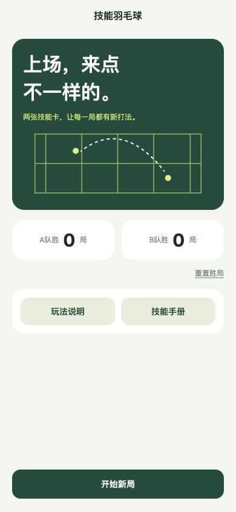
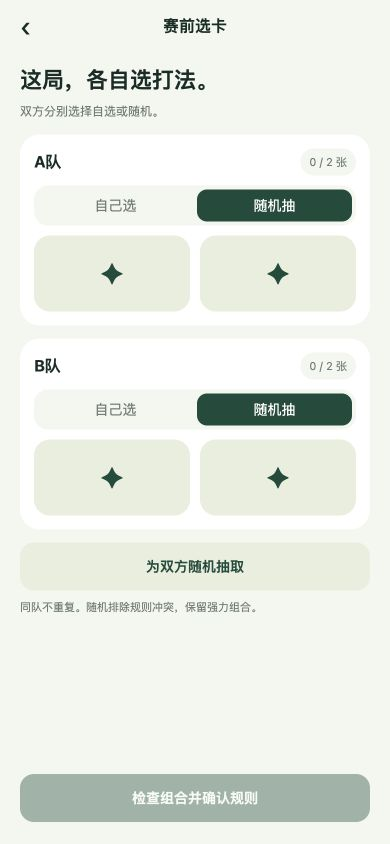
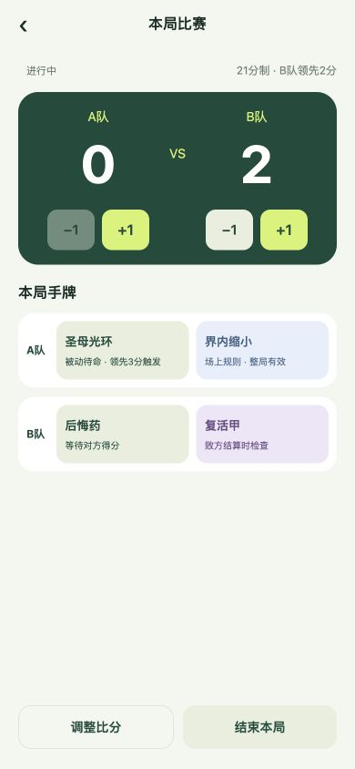
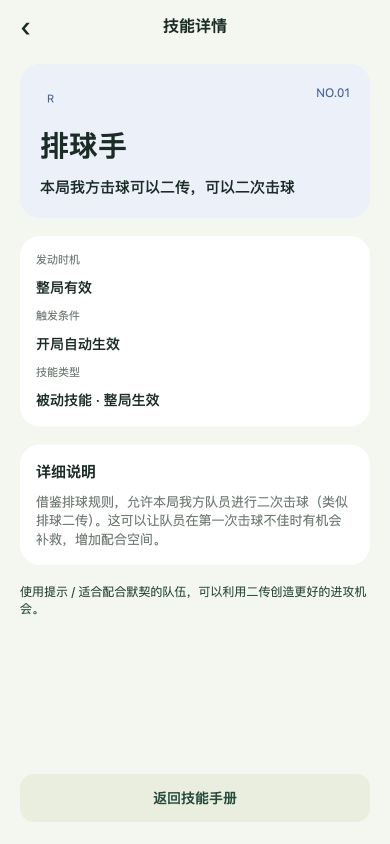

# 技能羽毛球

上场，来点不一样的。

一个将技能卡玩法融入羽毛球双打的 Web 交互体验项目。双方各获得两张技能，在上场前确认组合与规则，比赛中通过记分和技能操作处理效果，让每一局都有不同的打法。

**[在线体验](https://q499439909.github.io/skill-badminton/)** · 手机与桌面浏览器均可打开，无需登录。

## 扫码体验

用手机扫描下方二维码即可打开交互体验版，也可以点击二维码直接进入。

<p align="center">
  <a href="https://q499439909.github.io/skill-badminton/">
    
  </a>
</p>

## 界面预览

以下截图来自线上 Web 体验版的手机尺寸界面。

<table>
  <tr>
    <th>首页与体验入口</th>
    <th>双方独立选择自选或随机</th>
  </tr>
  <tr>
    <td></td>
    <td></td>
  </tr>
  <tr>
    <th>比赛记分与技能状态</th>
    <th>完整技能详情</th>
  </tr>
  <tr>
    <td></td>
    <td></td>
  </tr>
</table>

## 玩法与体验流程

1. **双方独立选择获取方式**。A 队、B 队分别选择自主选卡或随机抽卡，支持一队自选、另一队随机。
2. **每队获得两张不同技能**。可查看技能详情、按稀有度筛选，并调整自选手牌。
3. **统一检查四卡组合**。自选和随机共用组合规则，通过后核对技能及开局比分，确认开赛。
4. **记分与发动技能**。比赛页展示双方比分、手牌状态和剩余次数，可在技能详情中发动主动技能。限时操作提供倒计时入口。
5. **完成赛后结算**。处理结束技能和金球加赛，最终确定胜方后累计胜局，支持再来一局、返回首页和重置胜局。

首页提供玩法说明与技能手册。手册收录 25 张技能，可连续浏览，并查看效果、发动时机、触发条件、详细说明和使用提示。

## 规则设计

项目将组合冲突、技能结算顺序和强度提醒分别处理。

| 处理内容 | 当前规则 |
| --- | --- |
| 同队重复 | 每队两张技能不同，跨队普通技能允许重复 |
| 规则冲突 | 阻止双方同时持有平分秋色、双方同时持有逆转护符，以及两个 3V1 或 3V1 与临时换队友同场 |
| 随机组合 | 在揭晓前检查完整四卡组合，混合模式保留自选方手牌 |
| 强力组合 | 允许开局领先与双倍得分等组合，第一版不做复杂强度匹配 |
| 基础赛制 | 21 分制，领先 2 分获胜，30 分封顶 |
| 15 分节点 | 达到或跨过 15 分时处理，分数交换在同一节点只执行一次 |
| 回合确认 | 先确认击掌、预言及限时撤销等回合效果，再判断胜负 |
| 赛后顺序 | 先检查逆转护符，再检查当前败方的复活甲。金球加赛不再次连锁结束技能 |

例如，A 队持有「平分秋色」，比分达到 20∶20 时会进入胜负结算。如果 B 队还有符合条件且未使用的「复活甲」，页面会先询问是否金球加赛，完成后再记录最终胜局。

随机抽取先按 SSR、SR、R、N 的基础权重 5%、15%、40%、40% 选择稀有度，再从该等级内抽卡。同队去重和组合兼容筛选会改变最终分布。

## 技术实现

使用原生 HTML、CSS 和 JavaScript，通过 GitHub Pages 托管。运行时无需安装前端依赖。

| 文件 | 职责 |
| --- | --- |
| `index.html` | 页面入口，按顺序加载样式和脚本 |
| `skills.js`、`b-details.json` | 25 张技能的数据及详情文案 |
| `rules.js` | 四卡组合检查、开局比分和兼容随机抽取 |
| `match-engine.js` | 回合状态、技能次数、持续效果与赛后结算 |
| `app.js` | 基础页面、操作入口和渲染逻辑 |
| `compact.js`、`review.js` | 选卡分页、手册连续浏览、规则总览及屏幕适配 |
| `details.js` | 完整技能详情与选卡操作 |
| `match-runtime.js` | 将记分、技能发动和结算弹窗接入规则引擎 |
| `style.css`、`compact.css` | 视觉样式与移动端布局 |

手机端使用浏览器可用高度和安全区域布局，隐藏外层展示栏与模拟状态栏。长列表和详情在内容区域内滚动。

## 本地运行

需要 Git 和 Python 3。在终端执行以下命令。

```bash
git clone https://github.com/q499439909/skill-badminton.git
cd skill-badminton
python3 -m http.server 8765 --bind 127.0.0.1
```

打开 <http://127.0.0.1:8765/> 即可体验。技能详情会读取同目录 JSON，请通过 HTTP 服务访问页面。

## 当前实现范围

- 本仓库提供小程序交互的 Web 体验版，包含实际选卡、记分和技能结算逻辑。
- 双方共用一个页面操作。比赛和胜局数保存在当前页面内存中，刷新后重置。
- 发球、出界、击球方式、指定对象和人员调整由双方在场上确认。页面负责提示与录入后的结算。
- 「薛定谔的边界」由持卡方依据场上事实，在对方得分后的 3 秒窗口内选择改判。页面不识别球的实际落点。
- 尚未提供账户、跨设备同步和历史比赛持久化。

## 部署

GitHub Pages 从 `main` 分支的根目录发布。仓库根目录包含 `.nojekyll`，静态文件提交到 `main` 后会触发 Pages 构建与部署。

更新后可在仓库的 **Actions** 中查看发布结果。线上入口为 <https://q499439909.github.io/skill-badminton/>。
